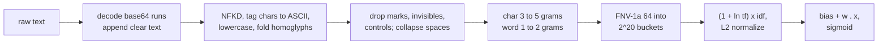

# Architecture

The README diagram shows the layers; this page follows a prompt through the code.

## Scoring path

1. `normalize.py` / `rust/src/normalize.rs`: undo obfuscation (ADR 0003).
2. `features.py` / `rust/src/features.rs`: hashed n-grams and sublinear TF-IDF. Texts
   longer than 4,096 normalized characters keep the first and last 2,048.
3. `model.py` (`LinearDetector`) and `rust/src/model.rs` (`LinearModel`): the logistic
   score, batch scoring in parallel with rayon, and per-n-gram explanations.

The Python API calls the Rust core through `pid_rs` (PyO3) when it is built and falls
back to the Python reference implementation otherwise (`_backend.py`). Setting
`PID_REQUIRE_RUST=1` turns the fallback into an error, which CI uses.

## Training path

`LinearDetector.train` calls `pid_rs.train_ftrl`:

1. Document frequencies over all training texts (parallel fold over rayon workers) give
   the IDF vector.
2. For each epoch, a SplitMix64-seeded Fisher-Yates permutation orders the examples.
   Blocks of 8,192 examples are featurized in parallel, then applied as sequential
   FTRL-Proximal updates, so the result does not depend on the thread count and matches
   `ftrl.train_reference` (checked by the parity tests).
3. The final weights are computed from the FTRL state and returned as little-endian
   float64 bytes. `quantized()` rounds them to float16 for the shipped model.

## Data path

`data.py` loads 13 public sources, `normalize`s each text for exact deduplication,
drops label conflicts, groups near-duplicates with `pid_rs.near_duplicate_groups`
(MinHash and banded LSH with union-find, ADR 0004) and assigns whole groups to splits.

## Transformer path

`transformer.py` fine-tunes `intfloat/multilingual-e5-small` with frozen word
embeddings (ADR 0005) and scores any sequence-classification checkpoint, including the
reference model, with length-sorted batches on Apple MPS.

## Service

`service.py` is a standard-library `ThreadingHTTPServer`. `App.handle` does the
routing and validation without a socket, which is what the tests exercise; scoring a
batch releases the GIL inside the Rust core.

| Route | Method | Purpose |
|---|---|---|
| `/v1/detect` | POST | `{"text": ...}` or `{"texts": [...]}`, optional `explain`, `threshold` |
| `/health` | GET | liveness and version |
| `/ready` | GET | model loaded, feature dimension |
| `/metrics` | GET | Prometheus text: requests by route and status, latency histogram, texts scanned and flagged |
